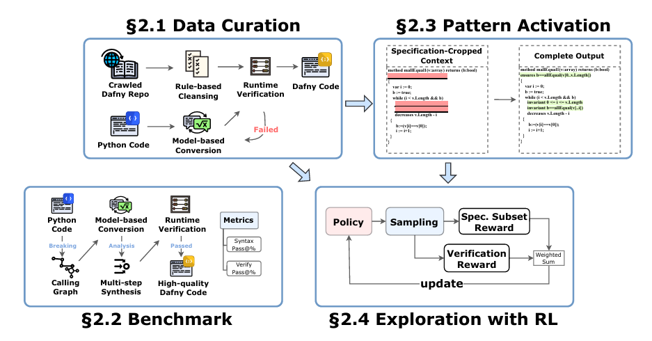
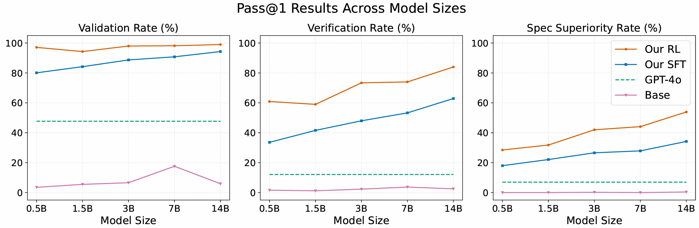
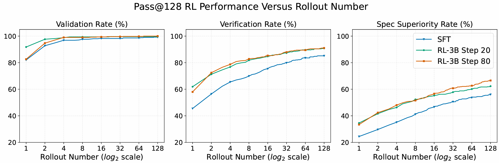

# Veri-Code
[🌐 Project Page](https://veri-code.github.io/ReForm-page) | [📄 arXiv Paper](https://arxiv.org/abs/2507.16331)


A framework for code to specification generation using large language models, based on Supervised Fine-Tuning (SFT) and Reinforcement Learning (RL).




## Table of Contents
- [Installation](#installation)
- [Dataset and Model](#dataset-and-model)
- [Quick Reproduction](#quick-reproduction)
- [Training](#training)
- [Evaluation](#evaluation)
- [SFT Training](#sft-training)
- [Reference](#reference)
- [License](#license)

## Installation
We recommend using conda for environment setup:

```bash
conda create -n vericode python=3.10
conda activate vericode

pip install torch==2.6.0

# Install FlashAttention (make sure your CUDA and PyTorch versions match)
wget https://github.com/Dao-AILab/flash-attention/releases/download/v2.7.4.post1/flash_attn-2.7.4.post1+cu12torch2.6cxx11abiFALSE-cp310-cp310-linux_x86_64.whl
pip install flash_attn-2.7.4.post1+cu12torch2.6cxx11abiFALSE-cp310-cp310-linux_x86_64.whl

pip install -r requirements.txt
```

## Dataset and Model
- The Python2Dafny dataset is located in the dataset/ directory.

- SFT and RL model checkpoints can be downloaded from https://huggingface.co/Veri-Code.

Available checkpoints:

- SFT : sft_0.5B, sft_1.5B, sft_3B, sft_7B, sft_14B

- RL fine-tuned model: 14B-RL-entropy

Available datasets:

- Python2Dafny: 18k

- DafnyComp: 300

These dataset are in json format.
If you want to use the whole 18k data or your own json data for training, you can use 
```bash
python -m src.data_preprocess
```
to transform these json format data to parquet files for training.

## Quick Reproduction
The repository now supports a minimal reproduction path that uses the released Hugging Face assets and the default smoke checkpoint. The shortest path is:

1. set up the `vericode` environment
2. download the released datasets and the `ReForm-SFT-0.5B` checkpoint
3. preprocess the Python2Dafny JSON into `dataset/train.parquet` and `dataset/test.parquet`
4. run the GPU smoke job or the full training script

### 1. Download released assets

```bash
conda activate vericode

python -c "from huggingface_hub import snapshot_download; snapshot_download('Veri-Code/ReForm-Python2Dafny-Dataset', repo_type='dataset', local_dir='hf_assets/datasets/ReForm-Python2Dafny-Dataset'); snapshot_download('Veri-Code/ReForm-DafnyComp-Benchmark', repo_type='dataset', local_dir='hf_assets/datasets/ReForm-DafnyComp-Benchmark'); snapshot_download('Veri-Code/ReForm-SFT-0.5B', local_dir='sft_ckpts/sft_0.5B')"
```

If you already have the JSON under `hf_assets/datasets/ReForm-Python2Dafny-Dataset/python2dafny_18k.json`, `src/data_preprocess.py` will use it directly.

### 2. Build the parquet files

```bash
python -m src.data_preprocess \
  --dataset_path hf_assets/datasets/ReForm-Python2Dafny-Dataset/python2dafny_18k.json \
  --local_dir dataset
```

This creates the default files expected by `train.sh`:

- `dataset/train.parquet`
- `dataset/test.parquet`

### 3. Run a smoke check

If you have a local GPU, add the bundled Dafny binary to `PATH` and run the smoke script:

```bash
export PATH="$PWD/hf_assets/tools/dafny-4.11.0/dafny:$PATH"
export DOTNET_SYSTEM_GLOBALIZATION_INVARIANT=1
python scripts/repro_gpu_smoke.py \
  --model_path sft_ckpts/sft_0.5B \
  --parquet dataset/test.parquet
```

The smoke job checks that the checkpoint loads, Dafny runs, and `verl.trainer.main_ppo` can finish a one-sample validation pass on the downloaded assets.
The SiFlow YAML creates its one-row smoke parquet files from `dataset/train.parquet` and `dataset/test.parquet` automatically.

### 4. Run the full training script

After the smoke check, launch the default RL script:

```bash
MODEL_PATH=sft_ckpts/sft_0.5B \
TRAIN_FILE=dataset/train.parquet \
EVAL_FILE=dataset/test.parquet \
bash train.sh
```

For multi-node training, use `bash train_multi_node.sh` instead.


## Training

To train using reinforcement learning (RL), you must first obtain a supervised fine-tuned (SFT) model. Download a checkpoint (e.g., sft_0.5B) and set MODEL_PATH in train.sh accordingly.

The dataset used for training and evaluation is Python2Dafny by default.

### Hyperparameters 
- reward_model.score_version: [0.4,0.4] for Subset reward, [0.8, 0.0] for naive reward
- actor_rollout_ref.actor.use_kl_loss=True and actor_rollout_ref.actor.kl_loss_coef=0.01 for KL loss, False and 0.0 for no KL loss
- actor_rollout_ref.actor.entropy_coeff=0.01 for entropy loss, 0.0 for no entropy loss


### Single-node training

```bash
bash train.sh
```

### Multi-node training
We use ray for multi-node training.

```bash
bash train_multi_node.sh
```


## Evaluation




To evaluate the model, please input the log directory of the model you want to evaluate. The default folder name for the log directory is `logs` if you use the default training script.
```bash
python -m src.evaluation --workers 96 --folder_name logs/YOUR_LOG_DIR
```

Evaluation logs (in JSON format) will be saved to the `eval_logs` folder by default.

To visualize results:

```bash
python src.plot --file_list eval_logs/YOUR_SCORE_JSON_FILES --training_length TRAINING_LENGTH
```

Here, `TRAINING_LENGTH` can be the number of validation times (number of dafny files in your log) minus 1.


## SFT Training
If you want to train the SFT model by yourself, please refer to `LLaMA-Factory/README.md` for details.

## Reference
This repository build on top of [LLaMA-Factory](https://github.com/hiyouga/LLaMA-Factory) and [Verl](https://github.com/volcengine/verl). 

The `verl/` directory is primarily copied from the Verl repository. We made modifications in the directory `verl/trainer/` and `verl/utils/reward_score/`.

## Citation

If you use this work in your research, please cite:

```bibtex
@misc{yan2025reformreducinghuman,
      title={Re:Form -- Reducing Human Priors in Scalable Formal Software Verification with RL in LLMs: A Preliminary Study on Dafny}, 
      author={Chuanhao Yan and Fengdi Che and Xuhan Huang and Xu Xu and Xin Li and Yizhi Li and Xingwei Qu and Jingzhe Shi and Zhuangzhuang He and Chenghua Lin and Yaodong Yang and Binhang Yuan and Hang Zhao and Yu Qiao and Bowen Zhou and Jie Fu},
      year={2025},
      eprint={2507.16331},
      archivePrefix={arXiv},
      primaryClass={cs.CL},
      url={https://arxiv.org/abs/2507.16331}, 
}
```

## License

The Re:Form-specific code and documentation in this repository are released under the MIT License. Third-party components keep their original licenses; in particular, `LLaMA-Factory/` and the copied `verl/` code include Apache-2.0 notices.

### MIT License

Copyright (c) 2025 Veri-Code authors

Permission is hereby granted, free of charge, to any person obtaining a copy
of this software and associated documentation files (the "Software"), to deal
in the Software without restriction, including without limitation the rights
to use, copy, modify, merge, publish, distribute, sublicense, and/or sell
copies of the Software, and to permit persons to whom the Software is
furnished to do so, subject to the following conditions:

The above copyright notice and this permission notice shall be included in all
copies or substantial portions of the Software.

THE SOFTWARE IS PROVIDED "AS IS", WITHOUT WARRANTY OF ANY KIND, EXPRESS OR
IMPLIED, INCLUDING BUT NOT LIMITED TO THE WARRANTIES OF MERCHANTABILITY,
FITNESS FOR A PARTICULAR PURPOSE AND NONINFRINGEMENT. IN NO EVENT SHALL THE
AUTHORS OR COPYRIGHT HOLDERS BE LIABLE FOR ANY CLAIM, DAMAGES OR OTHER
LIABILITY, WHETHER IN AN ACTION OF CONTRACT, TORT OR OTHERWISE, ARISING FROM,
OUT OF OR IN CONNECTION WITH THE SOFTWARE OR THE USE OR OTHER DEALINGS IN THE
SOFTWARE.
